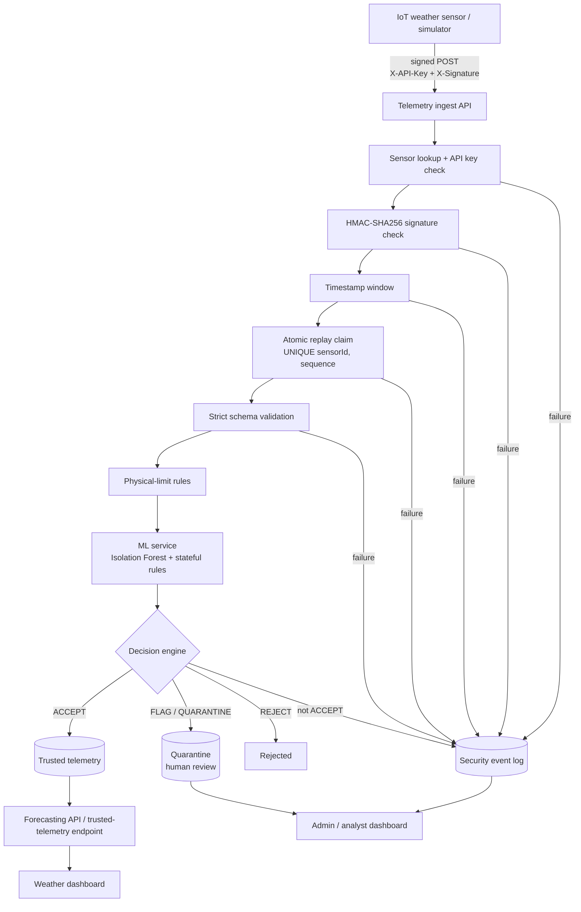

# Secure-Heat

**An AI-assisted security layer for IoT weather-station data pipelines.**

Weather stations stream temperature, humidity, pressure, wind, rainfall and solar-radiation readings to forecasting systems. A compromised or spoofed sensor can feed those systems manipulated data. Secure-Heat sits between the sensors and the forecaster: it authenticates every sensor, verifies every message cryptographically, rejects replays, scores every reading with a machine-learning model plus a rule engine, and only lets **trusted** data reach forecasting. Everything else is quarantined, rejected, or held for a human decision, and every decision is explained and audit-logged.

> **Synthetic data notice.** The dataset, the model metrics and the seeded dashboard data are all **synthetic**. They show that the pipeline works end to end. They are *not* real meteorological observations and say nothing about real-world detection accuracy.

---

## Contents

1. [Verification status (read this first)](#1-verification-status-read-this-first)
2. [Architecture](#2-architecture)
3. [Technology stack](#3-technology-stack)
4. [Repository layout](#4-repository-layout)
5. [Quick start with Docker](#5-quick-start-with-docker)
6. [Manual installation](#6-manual-installation)
7. [Environment variables](#7-environment-variables)
8. [Database setup](#8-database-setup)
9. [ML model training and evaluation](#9-ml-model-training-and-evaluation)
10. [Running the sensor simulator](#10-running-the-sensor-simulator)
11. [API documentation](#11-api-documentation)
12. [Tests](#12-tests)
13. [Security design](#13-security-design)
14. [Roles and permissions](#14-roles-and-permissions)
15. [Limitations](#15-limitations)
16. [Future enhancements](#16-future-enhancements)
17. [Troubleshooting](#17-troubleshooting)

---

## 1. Verification status (read this first)

This project was built in an environment without Docker, PostgreSQL, or access to package registries. That limits what could be executed during development. The table is deliberately blunt so you know what to trust and what to check on your first run.

| Component | Status |
|---|---|
| ML pipeline (dataset, training, evaluation, rules, detector) | **Executed.** 20 unit tests pass; metrics below are real outputs. |
| Ingestion pipeline, HMAC/crypto, decision engine, validators, workflow rules | **Executed.** 55 backend tests pass (run with an in-memory database fake). |
| Sensor simulator | **Executed.** 12 unit tests pass. |
| End to end: simulator → real TypeScript pipeline → real trained model | **Executed** (11 scenario checks pass), with the database faked in memory and a small standard-library stand-in for the FastAPI wrapper. |
| Express routes, controllers, Prisma queries, raw SQL, seed script | **Written, not executed.** Needs PostgreSQL and installed packages. |
| FastAPI app (`ml-service/app/main.py`) | **Written, not executed** (FastAPI was not installable). Its logic lives in the tested detector module. |
| React frontend | **Written and syntax-checked; not built.** 13 render checks of the UI building blocks pass. The Vitest/Testing Library suite is written but was not run. |
| Prisma migration SQL (`backend/prisma/migrations`) | **Hand-written, not run.** See [Database setup](#8-database-setup) for the regeneration fallback. |
| Dockerfiles / `docker-compose.yml` / nginx config | **Written, not built.** Compose file structure and shell scripts were validated; images were not built. |

**Expect small fixes on first run** (a type error, a mistyped column name). Everything that could be tested without the missing infrastructure was tested, including the security-critical logic.

---

## 2. Architecture



Plain-text version of the same flow:

```
IoT sensor ─► Ingest API ─► API key ─► HMAC ─► timestamp ─► replay claim ─► schema
                                                                              │
                                  physical-limit rules ◄──────────────────────┘
                                          │
                                          ▼
                       ML service (Isolation Forest + stateful rules)
                                          │
                                          ▼
                                   Decision engine
                    ┌─────────────────────┼──────────────────────┐
                    ▼                     ▼                      ▼
                 ACCEPT          FLAG / QUARANTINE             REJECT
                    │            (held for review)                │
                    ▼                     │                       ▼
            Forecasting API               ▼                 Security events
                    │              Quarantine page          (auth, signature,
                    ▼              (explicit approve /       replay, invalid)
            Weather dashboard       reject + audit log)
```

**Key invariant:** the forecasting side only ever sees rows whose status is `FORWARDED` (accepted automatically, or explicitly released by a human reviewer). Quarantined, flagged and rejected readings are never included.

### Services

| Service | Role |
|---|---|
| `frontend` | React SPA served by nginx, which also reverse-proxies `/api` to the backend (same origin, so the session cookie works). |
| `backend` | Express API: authentication, RBAC, sensor management, ingestion pipeline, events, quarantine, analytics. |
| `ml-service` | FastAPI: loads the trained Isolation Forest once at startup; scores readings and applies stateful rules. |
| `postgres` | Primary datastore (Prisma). |
| `sensor-simulator` | Five signed virtual stations with attack scenarios; control API used by the dashboard. |

### Decision outcomes

| Situation | Outcome |
|---|---|
| Unknown sensor, bad API key, bad signature | **REJECT** (401), `AUTHENTICATION_FAILURE` / `INVALID_SIGNATURE` event, nothing stored |
| Blocked / inactive sensor | **REJECT** (403), event |
| Stale/future timestamp or duplicate sequence number | **REJECT** (409), `REPLAY_ATTACK` event |
| Malformed payload (wrong types, unknown fields incl. a client-supplied anomaly score) | **REJECT** (400), `INVALID_TELEMETRY` event |
| Physically impossible value (e.g. humidity 150) | **QUARANTINE** (configurable to reject); can never be approved, only rejected |
| Strong ML anomaly | **QUARANTINE**; severity CRITICAL if an independent rule also fired |
| Moderate ML anomaly or soft rule (sudden change, repeated readings) | **FLAG**: held for review, low/medium severity, *not* described as an attack |
| ML service unreachable | **QUARANTINE** (default) or **REJECT**, never accept |
| Sensor marked suspicious | Even normal readings are **FLAG**ged until an admin reactivates it |
| Everything normal | **ACCEPT** → forwarded to forecasting |

Unusual weather is not treated as a cyberattack: a statistical anomaly alone yields FLAG/QUARANTINE with an explanation and the note that it is not proof of tampering.

---

## 3. Technology stack

| Layer | Technology |
|---|---|
| Frontend | React 18, TypeScript, Vite, Tailwind CSS, Recharts, Lucide React, React Router, Axios |
| Backend | Node.js 20, Express, TypeScript, Prisma ORM, PostgreSQL 16, JWT (httpOnly cookie), bcrypt (`bcryptjs`), Zod |
| ML service | Python 3.12, FastAPI, scikit-learn (Isolation Forest), pandas, NumPy, joblib, Pydantic |
| Security | HMAC-SHA256 request signing, per-sensor API keys (hashed), AES-256-GCM secret storage, replay protection, RBAC, rate limiting, Helmet, audit log |
| Delivery | Docker, Docker Compose, nginx |

---

## 4. Repository layout

```
secure-heat/
├── frontend/            React dashboard (pages, components, hooks, context, services, types, utils, tests)
├── backend/
│   ├── prisma/          schema.prisma, migrations/, seed.ts
│   ├── src/             config, controllers, middleware, routes, services, utils, validators
│   └── tests/           unit + end-to-end harness
├── ml-service/
│   ├── app/             FastAPI app, detector, preprocessing, rules, schemas
│   ├── scripts/         generate_dataset.py, tune_model.py, train_model.py, evaluate_model.py
│   ├── data/            generated synthetic datasets (not committed)
│   ├── models/          trained model + metrics (not committed)
│   └── tests/
├── sensor-simulator/    simulator.py, scenarios.py, tests/
├── scripts/             generate-env.sh, generate-env.ps1 (Windows)
├── docs/                ARCHITECTURE.md (design notes)
├── docker-compose.yml
├── .env.example
└── README.md
```

---

## 5. Quick start with Docker

Requirements: Docker with Compose v2.

**macOS / Linux / WSL / Git Bash:**

```bash
sh scripts/generate-env.sh          # creates .env with generated secrets; prints the admin email/password once
docker compose up --build           # first build trains the ML model: allow several minutes
```

**Windows PowerShell** (there is no `sh`; use the PowerShell script instead):

```powershell
powershell -ExecutionPolicy Bypass -File scripts\generate-env.ps1
docker compose up --build
```

Then open **http://localhost:8080** and log in with the admin credentials printed in step 1. Docker Desktop must be running. If you cannot run either script, copy `.env.example` to `.env` and fill in the blank secrets by hand (`JWT_SECRET`, `SENSOR_SECRET_ENC_KEY`, `ML_INTERNAL_TOKEN`, `SIM_CONTROL_TOKEN`, `SIMULATOR_TOKEN` = same value as `SIM_CONTROL_TOKEN`, `POSTGRES_PASSWORD`, `SEED_ADMIN_EMAIL`, `SEED_ADMIN_PASSWORD` of at least 12 characters). Make sure `DATABASE_URL` uses the same Postgres password.

What happens on first start:

1. PostgreSQL starts; the ML image has already generated the synthetic dataset, tuned, trained and evaluated the model during its build.
2. The backend applies database migrations, then (because `SEED_ON_START=true`) seeds users, five demo sensors, 24 hours of **synthetic** history and the ML metrics, and writes the sensors' one-time credentials to a shared volume for the simulator.
3. The simulator starts **idle**. Open **Simulator** in the dashboard and press **Start**, then inject an attack scenario and watch Live Monitoring, Security Events and Quarantine react.

Useful commands:

```bash
docker compose logs -f backend            # follow one service
docker compose down                       # stop (data kept)
docker compose down -v                    # stop and DELETE the database + credentials volume
docker compose exec backend node dist/prisma/seed.js   # re-run the seed
```

Ports: the dashboard is on `8080`. The backend API is published on `127.0.0.1:4000` only (handy for `curl`); PostgreSQL, the ML service and the simulator are **not** published.

For anything beyond a demo, set `SEED_ON_START=false` in `.env`, use strong unique passwords, and put TLS in front of the frontend (see [Security design](#13-security-design)).

---

## 6. Manual installation

Requirements: Node 20+, Python 3.11+, PostgreSQL 14+.

```bash
# --- ML service ---
cd ml-service
python -m venv .venv && source .venv/bin/activate
pip install -r requirements.txt
python scripts/generate_dataset.py && python scripts/tune_model.py && python scripts/train_model.py && python scripts/evaluate_model.py
ML_INTERNAL_TOKEN=<same value as backend> uvicorn app.main:app --port 8000

# --- Backend ---
cd ../backend
npm install
cp ../.env.example ../.env          # then fill in the required values (see section 7)
npx prisma migrate deploy           # or: npx prisma migrate dev
npm run seed
npm run dev                         # http://localhost:4000

# --- Frontend (proxies /api to localhost:4000) ---
cd ../frontend
npm install
npm run dev                         # http://localhost:5173

# --- Simulator (credentials were written by the seed) ---
cd ../sensor-simulator
pip install -r requirements.txt
SIM_CONTROL_TOKEN=<token> python simulator.py serve --control-port 5055
```

The backend loads configuration from the process environment. Export the variables from `.env` (e.g. `set -a; . ../.env; set +a`) or use your process manager's env-file support.

---

## 7. Environment variables

All variables are listed with comments in [`.env.example`](.env.example). **Never commit `.env`.** `sh scripts/generate-env.sh` fills in the secrets for you.

| Variable | Required | Purpose |
|---|---|---|
| `DATABASE_URL` | yes (manual) | PostgreSQL URL. Compose builds it from the three `POSTGRES_*` values. |
| `JWT_SECRET` | **yes** | Session signing key, ≥ 32 characters. The backend refuses to start without it. |
| `SENSOR_SECRET_ENC_KEY` | **yes** | 32 random bytes, base64. Encrypts sensors' HMAC secrets at rest. Losing it invalidates all sensor secrets. |
| `ML_INTERNAL_TOKEN` | recommended | Shared secret between backend and ML service (`X-Internal-Token`). |
| `SEED_ADMIN_EMAIL` / `SEED_ADMIN_PASSWORD` | for seeding | Initial admin (password ≥ 12 chars). Analyst/viewer accounts optional via `SEED_ANALYST_*`, `SEED_VIEWER_*`. |
| `SEED_ON_START` | Docker | `true` seeds on container start (demo). Set `false` for anything real. |
| `TIMESTAMP_WINDOW_SECONDS` | no (120) | Accepted clock skew for signed requests. |
| `FLAG_THRESHOLD` / `QUARANTINE_THRESHOLD` | no (0.99 / 0.999) | Percentiles of clean calibration scores. Flag = hold for review; quarantine = strong evidence. |
| `ML_FAIL_MODE` | no (`quarantine`) | `quarantine` or `reject` when the ML service is down. There is intentionally **no** pass-through option. |
| `RANGE_VIOLATION_ACTION` | no (`quarantine`) | `quarantine` or `reject` for physically impossible values. |
| `LIMIT_*`, `CHANGE_*`, `REPEAT_LIMIT` | no | Physical limits and rule thresholds (shared defaults in backend and ML service). |
| `CORS_ORIGIN`, `TRUST_PROXY`, `COOKIE_SECURE` | no | Browser origin(s), proxy trust, cookie flags (`Secure` is forced on in production). |
| `RATE_LIMIT_*`, `AUTH_RATE_LIMIT_MAX`, `INGEST_RATE_LIMIT_MAX` | no | Request rate limits. |
| `SIMULATOR_URL`, `SIMULATOR_TOKEN`, `SIM_CONTROL_TOKEN` | for the dashboard simulator | Backend proxy target and the control token the simulator requires. |
| `FORECASTING_URL`, `FORECASTING_TOKEN` | no | Optional external forecasting API; only accepted readings are ever sent. |
| `ML_METRICS_PATH`, `SENSOR_CREDENTIALS_PATH` | no | File locations used by the seed. |

---

## 8. Database setup

The schema is in `backend/prisma/schema.prisma`: `User`, `Sensor`, `Telemetry`, `SecurityEvent`, `ModelMetrics`, `ReplayRecord`, plus `AuditLog` (an addition: it records logins, sensor changes, incident updates and quarantine decisions).

Notable constraints:

* `ReplayRecord` has `UNIQUE (sensorId, sequenceNumber)`. Replay protection is a single `INSERT`; if two identical requests race, exactly one insert wins. There is no read-then-write window.
* Sensors store only `apiKeyHash` and an **encrypted** `secretKey`; neither is ever returned by any API.
* Telemetry is indexed by `(sensorId, timestamp)` and `(processingStatus, timestamp)`.

```bash
cd backend
npx prisma migrate deploy      # apply migrations (production / Docker)
npx prisma migrate dev         # apply + allow schema changes (development)
npm run seed                   # users, demo sensors, synthetic history, ML metrics
```

> **Migration caveat.** `prisma/migrations/…_init/migration.sql` was written by hand because Prisma could not be run during development. If `migrate deploy` reports an error or schema drift, regenerate it from the schema (this is safe on a fresh database):
> ```bash
> rm -rf prisma/migrations
> npx prisma migrate dev --name init
> ```

Seeded data is synthetic and every seeded event description starts with `[seed]`.

---

## 9. ML model training and evaluation

Everything is reproducible from a seed and runs offline; the API service **loads** the trained model at startup and never trains per request.

```bash
cd ml-service
python scripts/generate_dataset.py   # synthetic-v2-seed42: 5 stations x 30 days x 10 min
python scripts/tune_model.py         # grid search on the VALIDATION split only
python scripts/train_model.py        # fits on clean data, calibrates thresholds on held-out clean data
python scripts/evaluate_model.py     # one evaluation on the TEST split -> models/metrics.json
```

**Data.** Clean training split (10,800 rows) → validation (4,320 rows, 270 anomalous) → test (6,480 rows, 346 anomalous), split by time. Anomalies injected: temperature spikes, humidity inconsistent with surroundings, impossible values, pressure jumps, repeated identical readings, wind spikes, slow sensor drift, and multi-variable anomalies.

**Model.** scikit-learn `IsolationForest` (300 trees) trained on clean data only. Features are per-sensor residuals (deviation from that sensor's own hourly baseline, change versus the median of recent readings) plus two "largest deviation" summaries. The output is an **anomaly score = percentile among held-out clean calibration scores**. It is *not* a probability. Thresholds are percentiles of that distribution (flag 99th, quarantine 99.9th).

**Rules** are a separate engine: physical limits, sudden changes, and repeated identical readings. Repeated readings and impossible values are rule-based by design: a constant feature cannot be split by a forest.

**Results on the held-out synthetic test set** (`models/metrics.json`):

| Operating point | Precision | Recall | F1 | Confusion (TN / FP / FN / TP) |
|---|---|---|---|---|
| Flag (≥ 99th percentile) | 0.631 | 0.688 | 0.658 | 5995 / 139 / 108 / 238 |
| Quarantine (≥ 99.9th percentile) | 0.747 | 0.205 | 0.322 | 6110 / 24 / 275 / 71 |

ROC-AUC 0.954, average precision 0.632. Events caught at the flag threshold (ML alone): temperature spike 8/8, humidity 8/8, impossible values 7/7, multi-variable 7/7, pressure jump 5/5, wind spike 5/5, drift 5/5, repeated readings 1/5 (the rule engine covers the rest: ML + rules catch all event types).

Run through the stateful service path (the way the API actually calls it), ML + rules together reach precision 0.46, recall 0.95, F1 0.62 at row level. Most false positives are the first readings after an anomaly. Feature importance (permutation, drop in average precision): `max_dev` 0.22, `temp_dev` 0.10, `hum_dev` 0.08. See the ML Analytics page for the confusion matrix, per-type results and limitations.

Choices were made on the validation split; the test split was evaluated once.

---

## 10. Running the sensor simulator

The simulator never writes to the database. Every reading is HMAC-signed and POSTed to the real `/api/telemetry/ingest` endpoint.

**From the dashboard (recommended):** Simulator page → Start → choose a scenario and target → Inject. The page shows live telemetry and decision counters.

**From the command line:**

```bash
cd sensor-simulator
python simulator.py run --interval 5 --duration 120                      # normal operation
python simulator.py run --scenario temperature_spoof --target WS-002 --ticks 10
python simulator.py serve --control-port 5055                            # idle, controlled via HTTP
```

| Scenario | What it does | Expected result |
|---|---|---|
| `normal` | Healthy stations | ACCEPT |
| `temperature_spoof` | +14–22 °C on the target | QUARANTINE / FLAG |
| `humidity_manipulation` | inconsistent (8 %, 98 %) or impossible (150 %) humidity | FLAG / QUARANTINE (150 % can only be rejected) |
| `replay_attack` | re-sends a captured request verbatim | 409, `REPLAY_ATTACK` event |
| `wind_spike` | +28–45 m/s | QUARANTINE |
| `sensor_drift` | slow creeping offset | caught after a delay (see Limitations) |
| `forged_signature` | attacker without the secret | 401, `INVALID_SIGNATURE` event |

Credentials come from `credentials.json` (written by the seed, gitignored). If you rotate a sensor's credentials in the UI, the simulator's copy for that sensor is stale: re-seed or update the file.

### Sending a signed reading yourself

```python
import hashlib, hmac, json, time, requests
from datetime import datetime, timezone

SENSOR, API_KEY, SECRET = "WS-001", "<api key>", "<secret>"
ts  = datetime.now(timezone.utc).strftime("%Y-%m-%dT%H:%M:%SZ")
seq = int(time.time())                               # must never repeat for this sensor
body = {"sensorId": SENSOR, "timestamp": ts, "sequenceNumber": seq, "temperature": 22.5, "humidity": 61,
        "pressure": 1012.3, "windSpeed": 4.2, "windDirection": 180, "rainfall": 0, "solarRadiation": 310}
raw = json.dumps(body, separators=(",", ":")).encode()           # the exact bytes you send are the bytes you sign
canonical = "\n".join(["v1", SENSOR, ts, str(seq), hashlib.sha256(raw).hexdigest()])
sig = hmac.new(SECRET.encode(), canonical.encode(), hashlib.sha256).hexdigest()
r = requests.post("http://localhost:4000/api/telemetry/ingest", data=raw,
                  headers={"Content-Type": "application/json", "X-API-Key": API_KEY, "X-Signature": sig})
print(r.status_code, r.json())      # 201 {"status":"FORWARDED","decision":"ACCEPT",...}
```

---

## 11. API documentation

Base path `/api`. Browser endpoints use an httpOnly, `SameSite=Strict` session cookie and require the header `X-Requested-With: SecureHeat` on state-changing requests. Errors are JSON: `{ "error": "CODE", "message": "..." }`. Paged lists return `{ items, total, page, pageSize }`.

### Sensor ingestion (API key + HMAC, no cookie)

| Method | Path | Notes |
|---|---|---|
| POST | `/telemetry/ingest` | Headers `X-API-Key`, `X-Signature`. Body fields: `sensorId`, `timestamp` (ISO-8601 with zone), `sequenceNumber` (0…2³¹−1), `temperature`, `humidity`, `pressure`, `windSpeed`, `windDirection`, `rainfall`, `solarRadiation`. Unknown fields are rejected. |

Responses to sensors are deliberately minimal (`status`, `decision`, `telemetryId`) so a compromised sensor cannot learn thresholds or scores.

| Code | Meaning |
|---|---|
| 201 | accepted and forwarded |
| 202 | accepted for review (flagged/quarantined), or forwarding pending |
| 400 | malformed request / invalid payload |
| 401 | authentication failed (unknown sensor, bad key and bad signature look identical) |
| 403 | sensor blocked or inactive |
| 409 | replay: duplicate sequence number or timestamp outside window |
| 422 / 503 | rejected by policy (impossible value in reject mode / ML down in reject mode) |

### Dashboard API (session cookie)

Roles: **A** = Admin, **S** = Security analyst, **V** = Viewer.

| Method & path | Roles | Purpose |
|---|---|---|
| `POST /auth/login`, `POST /auth/logout`, `GET /auth/me` | public / any | Session management. `POST /auth/forgot-password` returns 501 until SMTP is configured. |
| `GET/POST /users`, `PATCH/DELETE /users/:id` | A | User management (cannot delete/demote the last admin). |
| `GET /sensors`, `GET /sensors/:sensorId` | A S V | List / detail with counts and recent events. |
| `POST /sensors` | A | Register; credentials returned **once**. |
| `PATCH /sensors/:sensorId/status` | A | Activate / deactivate / block (reason logged). |
| `POST /sensors/:sensorId/rotate-credentials` | A | New credentials returned once; old ones stop working immediately. |
| `POST /sensors/:sensorId/mark-suspicious` | A S | Opens an incident; subsequent readings are held for review. |
| `GET /telemetry`, `GET /telemetry/:id` | A S V | Filter by sensor, search, status, decision, date; sortable; detail includes the full pipeline result. |
| `GET /trusted-telemetry` | A S V | **Forecasting boundary:** only `FORWARDED` rows; no scores or explanations. |
| `GET /forecast/trends` | A S V | Hourly trusted means, naive "unprotected" series, baseline forecast, exclusion counts. |
| `GET /events`, `GET /events/:id` | A S V | Filter by severity, type, sensor, status, date. Detail includes the audit timeline. |
| `POST /events/:id/investigate`, `POST /events/:id/notes` | A S | Lifecycle and notes. |
| `POST /events/:id/resolve` | A | Resolve (notes required). |
| `GET /quarantine` | A S | `state=pending\|approved\|rejected`. |
| `POST /quarantine/:id/approve`, `/reject` | A S | Reason required; audit-logged; impossible values cannot be approved. |
| `GET /stats/overview` | A S V | KPIs, chart datasets, feed, sensor health. |
| `GET /analytics/model` | A S | Metrics, confusion matrices, importance, limitations. |
| `POST /analytics/model/refresh`, `/train` | A | Pull metrics from / retrain the ML service. |
| `GET /settings`, `GET /audit` | A | Effective configuration (no secrets); audit log. |
| `GET /simulator/status`, `/log`; `POST /simulator/start`, `/stop`, `/scenario` | A S | Authenticated proxy to the simulator control API. |

### ML service (internal; `X-Internal-Token` when configured)

| Method | Path | Purpose |
|---|---|---|
| POST | `/predict` | Score one reading → `anomaly_score`, `prediction`, `rules_triggered`, `rule_details`, `explanation`. 503 if the model is not loaded. |
| POST | `/train` | Retrain from the clean synthetic training set and reload. |
| GET | `/health` | `ok` or `degraded` (model missing/corrupt). |
| GET | `/metrics` | Latest evaluation metrics. |

---

## 12. Tests

```bash
# ML service (20 tests)
cd ml-service && python -m unittest discover -s tests          # or: pytest

# Backend (55 tests: crypto, validators, decision engine, ingestion scenarios 1-6, ML client, config/RBAC, query validation)
cd backend && npm test

# Sensor simulator (12 tests)
cd sensor-simulator && python -m unittest discover -s tests

# Frontend (Vitest + Testing Library: login, protected routes, role visibility, dashboard states, telemetry filtering)
cd frontend && npm test
```

Integration scenarios from the specification and where they are covered:

| # | Scenario | Covered by |
|---|---|---|
| 1 | Legitimate sensor, normal readings → ACCEPT | `backend/tests/ingest.test.ts` |
| 2 | Manipulated temperature spike → FLAG/QUARANTINE | ingest tests + end-to-end |
| 3 | Duplicate sequence number → REJECT + replay event | ingest tests (incl. 20 simultaneous duplicates) |
| 4 | Invalid HMAC → REJECT + auth event | ingest tests |
| 5 | Humidity = 150 → quarantine (configurable to reject) | ingest + decision tests |
| 6 | Unusual but possible weather → flagged, not labelled malicious | ingest + ML detector tests |
| 7 | Viewer tries to resolve an incident → HTTP 403 | RBAC matrix test (config); HTTP-level test **not yet written** (needs a database) |

End-to-end run (needs the ML shim and test harness; the database is faked): see `sensor-simulator/tests/e2e_run.py`, `backend/tests/e2e/harness.ts`, `ml-service/tests/stdlib_predict_server.py`.

---

## 13. Security design

| Threat | Control |
|---|---|
| Unknown / spoofed sensor | Per-sensor API key (256-bit random, only its SHA-256 stored) **and** a per-sensor HMAC secret. Unknown id, wrong key and wrong signature return identical responses to prevent enumeration. |
| Tampered or forged message | HMAC-SHA256 over `v1 \n sensorId \n timestamp \n sequence \n SHA-256(raw body)`. Signing the exact bytes avoids JSON/float formatting differences between languages. Constant-time comparison. |
| Replay | Timestamp window **and** an atomic `UNIQUE(sensorId, sequenceNumber)` insert; signature is verified *before* the sequence is claimed so unauthenticated callers cannot burn sequence numbers. |
| Stolen database | Sensor secrets are AES-256-GCM encrypted (key in env); API keys and passwords are hashed (bcrypt cost 12 for passwords). |
| Client-supplied verdicts | Strict schema; unknown fields (e.g. `anomalyScore`) are rejected. The decision is always computed server-side. |
| Poisoned forecasting | `FORWARDED`-only trusted view; quarantine requires explicit, reasoned, audit-logged approval; impossible values and blocked sensors can never be approved; atomic claim prevents double review. |
| ML outage | Fail-safe quarantine/reject; no pass-through setting exists. |
| Baseline poisoning | Delta features are measured against *trusted* history, with a staleness fallback so one anomaly cannot lock a sensor out. |
| Compromised sensor info leak | Responses to sensors contain only the decision and an id. |
| Web attacks | httpOnly + `SameSite=Strict` cookies, CSRF header + origin check, Helmet, CORS allow-list, request size limit, input validation (Zod), Prisma parameterised queries, no stack traces in errors, rate limits (stricter on failed logins), nginx security headers. |
| Privilege misuse | Server-side RBAC on every protected route; role is re-read from the database on each request; last-admin protection; all sensitive actions audit-logged. |
| Secrets in source | All secrets from the environment; the backend refuses to start with weak/missing secrets; the seed never hardcodes passwords. |

**Production hardening checklist:** terminate TLS in front of the frontend and keep `COOKIE_SECURE` on; set `SEED_ON_START=false`; use unique long secrets; set `TRUST_PROXY=true` only behind a proxy you control; restrict database and ML-service network access; rotate sensor credentials periodically; back up the database *and* `SENSOR_SECRET_ENC_KEY`.

---

## 14. Roles and permissions

| Capability | Admin | Security analyst | Viewer |
|---|:--:|:--:|:--:|
| View overview, monitoring, sensors, events | ✓ | ✓ | ✓ |
| View quarantine, ML analytics, simulator | ✓ | ✓ | – |
| Investigate incidents, add notes | ✓ | ✓ | – |
| Resolve incidents | ✓ | – | – |
| Approve / reject quarantined readings | ✓ | ✓ | – |
| Mark a sensor suspicious | ✓ | ✓ | – |
| Register / activate / block sensors, rotate credentials | ✓ | – | – |
| Manage users, settings, audit log, model refresh/retrain | ✓ | – | – |

Resolution is admin-only because the specification lists incident resolution under the admin role; it is a one-line change in `backend/src/config/permissions.ts` (and the mirror in `frontend/src/utils/permissions.ts`).

---

## 15. Limitations

* **Synthetic data only.** Model quality on real stations is unknown; real weather, instrument noise and real attacks are messier than the injected anomalies.
* **Precision.** About 4 in 10 flags are false alarms at the flag threshold, which suits "hold for review" but not automatic blocking.
* **Slow drift** can pass for several readings before it is flagged (in the end-to-end run, the first 9 readings of a 25-reading drift were accepted).
* **Isolation Forest scores unusualness, not intent.** Severe real weather can score high; that is why flags are explained and never labelled attacks.
* **The anomaly score is a percentile, not a probability.**
* **ML rule state is in memory.** The detector's per-sensor history resets on restart and is not shared across replicas; scale-out needs shared state.
* **Per-sensor baselines** exist only for the five demo sensors; new sensors use a generic fallback until the model is retrained.
* **No password reset email**, no multi-factor authentication, no per-account lockout (IP rate limiting only), and sessions are stateless (logout clears the cookie; tokens expire after the configured lifetime).
* **Credential rotation** in the UI does not update the simulator's local credentials file.
* **Forecasting is a baseline** (damped linear trend) used to illustrate the integrity boundary, not a competitive weather model.
* **Permutation importance** is global and approximate.
* **Not load tested.** The ingestion path performs several database operations per reading.
* See [Verification status](#1-verification-status-read-this-first) for what has not been executed.

---

## 16. Future enhancements

* Evaluate on real station data; calibrate scores into probabilities; add a dedicated drift detector (e.g. CUSUM) and cross-sensor consistency checks using neighbouring stations.
* Shared state (Redis) for ML history and rate limits; horizontal scaling.
* Mutual TLS or hardware-backed sensor identities; automatic key rotation.
* Password reset via email, MFA, session revocation list, per-account lockout.
* Server-sent events / WebSockets for live dashboards; alert notifications (email/webhook).
* Model monitoring and drift alerts; scheduled retraining with human approval.
* A production forecasting model behind the trusted-telemetry boundary.
* HTTP-level API test suite against a containerised database in CI.

---

## 17. Troubleshooting

| Symptom | Likely cause / fix |
|---|---|
| Backend exits: `JWT_SECRET must be set…` or `SENSOR_SECRET_ENC_KEY must be 32 bytes` | Run `sh scripts/generate-env.sh`, or set the values (`openssl rand -base64 32`). |
| `migrate deploy` fails | See the [migration caveat](#8-database-setup); regenerate with `prisma migrate dev --name init` on a fresh database. |
| Login works but every request is 401 | The session cookie is not being sent: access the app via the frontend origin (`:8080` in Docker, or the Vite dev server), not by calling the API from another origin. |
| `403 missing CSRF header` | State-changing browser requests need `X-Requested-With: SecureHeat` (the frontend adds it). |
| Telemetry always `401` | Wrong API key/secret, or the body bytes you signed differ from the bytes you sent (sign the exact serialised string). |
| Telemetry `409` | Reused sequence number, or your clock is more than `TIMESTAMP_WINDOW_SECONDS` away from the server's. |
| Everything is quarantined | The ML service is unreachable and `ML_FAIL_MODE=quarantine` (the safe default). Check `docker compose logs ml-service` and `ML_INTERNAL_TOKEN` matches on both sides. |
| Simulator page says "not running or unreachable" | `SIMULATOR_URL` / `SIMULATOR_TOKEN` must match the simulator's address and `SIM_CONTROL_TOKEN`. |
| Dashboard empty after a day | Seeded history covers 24 h and the simulator is idle by default; start the simulator. |
| ML image build is slow | It generates data and runs the model grid search (several minutes). Skip tuning by editing the ml-service Dockerfile to drop `tune_model.py` (defaults are used). |

---

*Secure-Heat is a university-level demonstration of AI-assisted IoT data-integrity protection. It has not been security-audited; do not use it to protect production systems without independent review.*
